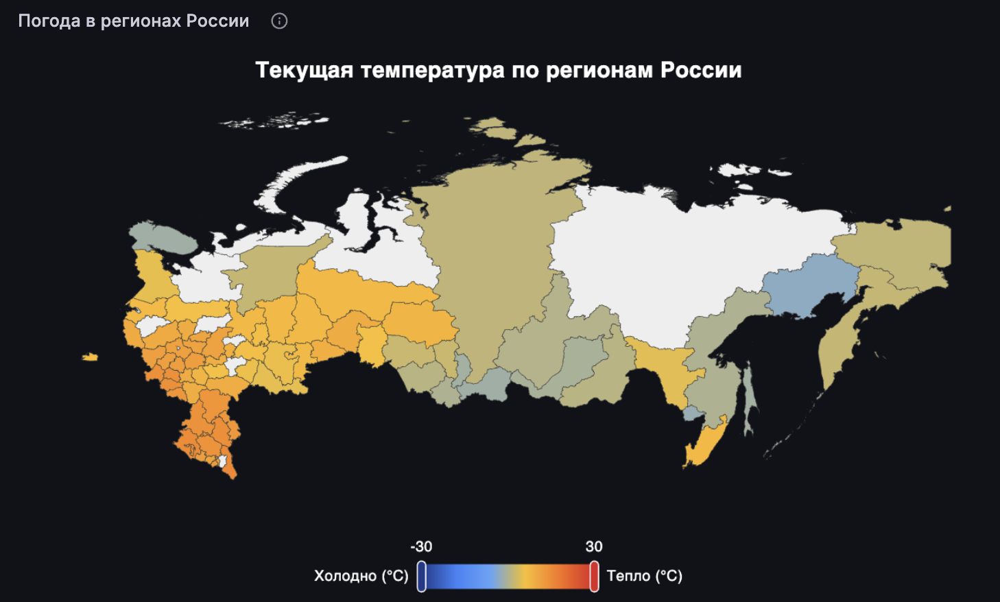
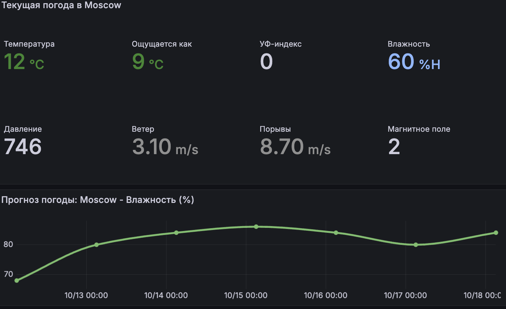
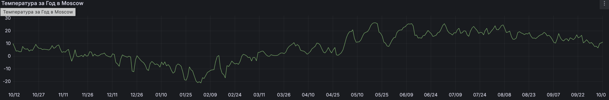

# Weather Pipeline: ETL + dbt + Grafana

End-to-end пайплайн для сбора, обработки и визуализации погоды по **419 городам России** с интерактивной **картой регионов**, **прогнозом** и **историей за год**.

## 🎬 Демо

https://github.com/annidcode/weather_pipeline/raw/main/docs/demo.mp4

## Бизнес-задача

Метеосервис хотел:
- Видеть **погоду по всей России** на интерактивной карте.
- Анализировать **историю за год** (тренды, аномалии).
- Показывать **прогноз на неделю** для выбранного города.
- Получать **текущую погоду** с УФ, влажностью, давлением, ветром.

## Архитектура

Яндекс.Погода API Open-Meteo API
↓
 
Текущая + прогноз 5д История за год

↓

SeaweedFS (S3) ← сырые parqut

↓

ClickHouse (raw)

↓

dbt (staging → mart)

↓

Grafana

↓

Airflow (ежедневный запуск в 6:00 МСК)

## Стек

- **Источники:** Яндекс.Погода API, Open-Meteo API
- **Хранилище:** SeaweedFS (S3), ClickHouse 24.3
- **Трансформации:** dbt (dbt-clickhouse)
- **Оркестрация:** Airflow 2.9
- **BI:** Grafana 10.4
- **Инфраструктура:** Docker Compose
- **Язык:** Python (pandas, requests, boto3, clickhouse-connect, shapely)


## 📊 Grafana-дашборды

### Дашборд 1: «Погода в регионах России»



Choropleth-карта **83 регионов** с тремя метриками:
- **Температура (°C)** — текущая погода.
- **Ветер (м/с)** — порывы.
- **Осадки (мм)** — за сутки.

Динамическая легенда, авто-диапазон.

### Дашборд 2: «Мой город»



- **Search bar** — выбор города из 419.
- **Stat-панель:** температура, ощущается как, УФ, влажность, давление, ветер, порывы, магнитное поле.
- **Прогноз на неделю** — Line Chart с переключением метрики.

### Дашборд 3: «История за год»



- **График температуры** за год / месяц / неделю / день.

## Что сделано

### 1. Данные
- **419 городов России** (GeoNames, население >50k).
- **Текущая погода** + **прогноз 5 дней** (Яндекс.Погода).
- **История за год** (152 988 строк, Open-Meteo).
- **83 региона России** (GeoJSON GADM).
- **Привязка городов к регионам** через shapely (пространственный индекс).

### 2. ETL-пайплайн
- `prepare_cities.py` — фильтр GeoNames.
- `assign_regions.py` — привязка городов к регионам.
- `fetch_yandex.py` — текущая + прогноз → S3.
- `fetch_openmeteo.py` — история → S3.
- `load_to_clickhouse.py` — S3 → ClickHouse.
- `load_forecast_to_clickhouse.py` — прогноз → ClickHouse.
- `load_geojson.py` — GeoJSON регионов → ClickHouse.

### 3. dbt-модели

**Staging:**
- `stg_yandex_current` — текущая погода.
- `stg_openmeteo_history` — история за год.
- `stg_yandex_forecast` — прогноз.

**Marts:**
- `city_summary` — сводка по городам.
- `region_summary` — агрегаты по регионам.
- `current_by_region` — текущая погода по регионам (для карты).
- `daily_weather` — динамика по дням.
- `weather_anomalies` — аномалии (z-score).

### 4. Оркестрация (Airflow)

DAG `weather_pipeline` с расписанием **`0 6 * * *`** (9:00 МСК):

fetch_yandex → load_to_clickhouse → load_forecast_to_clickhouse → dbt_run → dbt_test

- **Retries:** 2 попытки через 5 минут.
- **Max active runs:** 1.
- **Автообновление данных:** каждый день в 6:00 МСК.

## Ключевые концепции

- **ETL:** API → S3 → dbt → DWH.
- **dbt:** staging → marts, тесты данных.
- **Choropleth:** карта с покраской регионов по метрике.
- **GeoJSON:** границы регионов России.
- **Привязка данных:** города → регионы через shapely.
- **Оркестрация:** ежедневный запуск пайплайна через Airflow.

## Ограничения

- **Яндекс.Погода:** тестовый тариф (10 000 запросов). Прогноз только 5 дней.
- **Open-Meteo:** лимиты API (429 при частых запросах).
- **Choropleth в Superset:** не поддерживается, использована Grafana.
- **Локальный Airflow:** scheduler работает на Mac; в проде — на сервере.

## Как запустить

### 1. Инфраструктура
```bash
docker compose up -d
```

- Grafana: http://localhost:3000 (admin/admin)

- Airflow: http://localhost:8082

- ClickHouse: http://localhost:8125 (admin/admin123)

- SeaweedFS: http://localhost:8333

### 2. Данные

```bash
source .venv/bin/activate
export YANDEX_WEATHER_KEY="<ключ>"
export S3_ENDPOINT="http://localhost:8333"
export CH_HOST="localhost"
export CH_PORT="8125"

python3 scripts/fetch_yandex.py
python3 scripts/fetch_openmeteo.py
python3 scripts/load_to_clickhouse.py
python3 scripts/load_forecast_to_clickhouse.py
python3 scripts/load_geojson.py
```

### 3. dbt

```bash
cd dbt
export CH_HOST="localhost"
export CH_PORT="9002"
dbt run
dbt test
```

### 4. Grafana

http://localhost:3000 → Dashboards.


